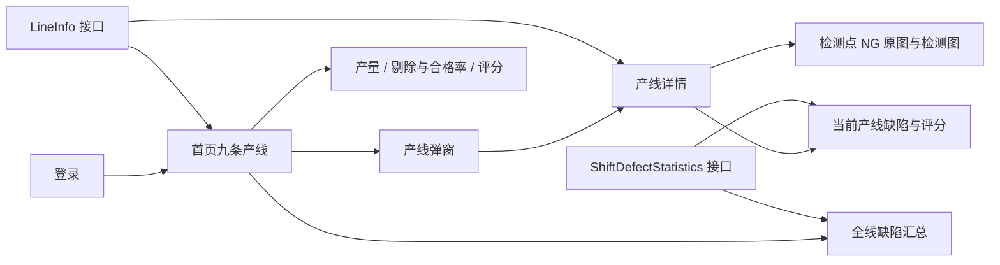
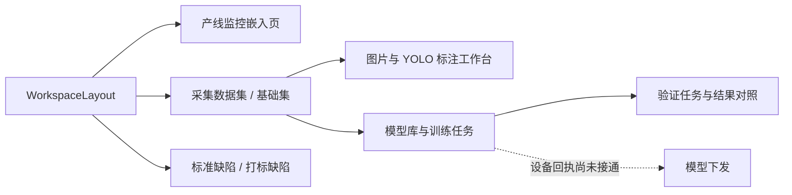
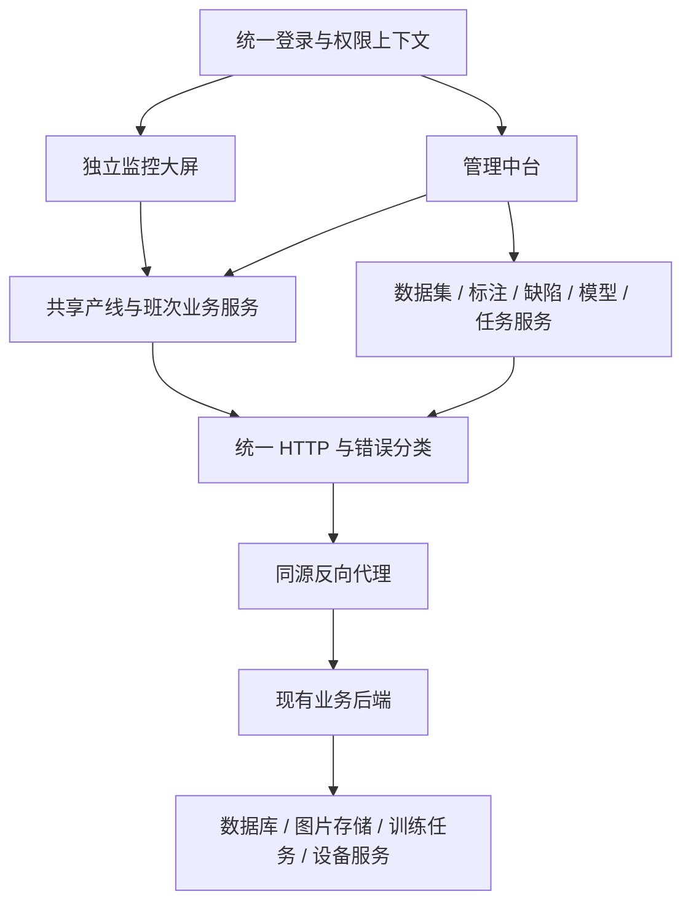

# AI 检测平台：master 与 whole 分支技术分析及整合方案

版本：V1.0  
分析日期：2026-10-16  
适用工程：jifangdaping

## 1. 结论与建设目标

目前工程形成了两条业务方向：**master 是生产监控大屏，whole 是面向操作人员的 Web 管理中台**。两者使用相同的前端基础技术，但在入口、页面容器、认证、图片代理及业务完整度上已经存在差异。whole 并不是包含 master 最新功能的完整上位版本。

建议采用“**一个代码仓库、两个页面入口、共享业务服务**”的整合方式：保留 master 最新大屏及评分规则，将 whole 的数据集、标注、缺陷、模型与验证模块按业务域迁入。大屏继续服务现场监控，中台服务采集、标注和模型迭代；不要求大屏必须嵌入管理导航，也不在本阶段引入微前端。

本方案是代码现状分析与后续实施建议，**本次没有实施分支合并、改动业务逻辑或调用真实业务写接口**。后文明确区分“已实现”“存在代码但尚未接入”“建议新增”和“需要服务端确认”。

## 2. 分析基线与验证范围

### 2.1 分支快照

| 项目 | 核对结果 |
| --- | --- |
| master | `7e16d193`，提交时间 2026-10-15 11:04:51 +08:00 |
| whole | `1220d7ba`，提交时间 2026-09-23 16:57:20 +08:00 |
| 共同祖先 | `33ea138897b711a149dac47b1994b04585c8c3f5` |
| 分叉关系 | master 独有 2 个提交，whole 独有 4 个提交 |
| 本地与远程跟踪引用 | 本地分支分别与本地 `origin/master`、`origin/whole` 一致；本次未 fetch，不能据此断言远端服务器没有新提交 |
| 初始工作区 | 无未提交变更 |
| 依赖差异 | 两分支 `package.json` 与 `package-lock.json` 的 Git 对象分别一致 |
| 主要差异范围 | 限定源码、文档、测试、脚本及关键配置，共 46 个文件，whole → master 为新增 699 行、删除 5867 行；这是比较方向，不代表建议删除中台 |

提交说明多为 `fix`，不能据此判断需求归属；本方案以具体文件、路由和实现为依据。比较时排除依赖与构建产物的体积噪声。

### 2.2 本次实际验证

| 检查项 | 结果与边界 |
| --- | --- |
| master 生产构建 | 通过，未覆盖仓库现有 dist |
| whole 生产构建 | 在隔离源码快照中通过，未切换当前分支 |
| whole 单元测试 | `tests/workspace.test.mjs`：5 项通过 |
| whole 原有 UI 测试 | 未通过；停在创建数据集时填写只读名称，见第 8 节 |
| 合并预演 | `git merge-tree --write-tree master whole` 检出冲突；未执行实际 merge |
| 真实服务端验收 | 未执行；构建和模拟接口测试不代表采集、训练、验证、下发已在生产环境验收 |

两个构建均存在大体积 JS 警告及 Mock.js eval 警告。构建使用现有安装依赖，未做两套全新依赖安装或跨浏览器认证。验证产生的依赖预构建缓存变更已恢复；方案以外不保留本次验证对仓库的修改。

## 3. 当前架构

### 3.1 共用基础

工程采用 Vue 3、Vite 4、Vue Router、Element Plus、ECharts、Axios、Sass；包含 Pinia、Three.js、GSAP、Mock.js 等依赖。源码主要混用 Options API 和 Composition API，尚未形成统一的业务服务层。

- 页面使用 Hash 路由。
- 登录信息写入 localStorage 的 `token`、`access_token`、`user_info`。
- 浏览器使用同源相对路径，Vite 根据 `BACKEND_URL` 转发接口和静态图片。
- 环境文件区分开发与部署，支持 `.env.*.local` 覆盖。
- `start.bat` 先构建，再启动监听 4173 端口的 Vite preview。
- Pinia 已注册，但关键产线和班次数据主要由页面局部状态管理；不能将“已安装 Pinia”等同于已有统一状态中心。

### 3.2 master：现场监控链路



首页的产线示意使用状态图片，评分采用九宫格仪表盘；详情页已将原合格率仪表改为机台评分，右侧展示当前产线缺陷分类。实时累计产量与所选班次统计分别来自不同接口。

### 3.3 whole：管理中台链路



whole 的产线首页通过 `ProductionPage.vue` 包装原有 Home，并新增可交互 GLB 模型：共享模型几何，每个机台实例维护材质、相机和渲染器，支持状态颜色、拖动旋转、运行输送动画、隐藏页面暂停及资源释放。它与 master 首页的图片方案不同，但两分支都还保留独立 `/3DModel` 页面，不能概括成“master 完全没有 3D”。

## 4. 两分支能力对照

| 业务域 | master 现状 | whole 现状 | 整合取舍 |
| --- | --- | --- | --- |
| 默认入口 | `/` 为独立大屏 | `/` 重定向 `/workspace/production` | 保留独立大屏，增加明确中台入口 |
| 管理导航 | 无 workspace 导航 | 左侧导航、顶部用户信息、内容区 | 保留 whole 壳层，仅用于中台 |
| 首页设备 | 九条产线状态图片 | 九台交互 GLB 模型 | 默认保留 master；3D 作为可配置增强项 |
| 首页分析 | 产量；剔除柱形与合格率折线；评分；整体缺陷汇总 | 较早版本产量、剔除及质量面板 | 以 master 最新业务口径为准 |
| 评分门槛 | 班次产量 ≥1000 才展示，支持负分、空值 | 未包含 master 最新评分模块 | 抽为共用规则，供两入口复用 |
| 详情页 | 评分、累计产量、检测点、当前线班次缺陷 | 嵌入较早详情页 | 共用详情业务内容，分别提供全屏与嵌入容器 |
| NG 图片 | 原图/检测图、分页、筛选与点位查询适配 | 保留图片能力，但商标纸点位映射较早 | 保留 master 新映射并逐点回归 |
| 采集与基础集 | 无管理页面 | 查询、创建/删除、采集、基础集查看 | 迁入，真实接口契约逐项验收 |
| 标注 | 无数据集标注编辑工作台 | YOLO 矩形标注、保存、删除、未保存提醒 | 保留 whole，并优先明确类别映射 |
| 模型与任务 | 无管理模块 | 模型库、训练、验证、参数编辑 | 迁入，提交成功与任务完成分开 |
| 模型下发 | 无 | 按钮禁用，等待设备完成回执 | 服务端闭环完成前不启用 |
| 质量分析 | 大屏内可用的整体和单线统计 | 有 `QualityPage.vue`，但路由未指向它 | 单独接通质量分析路由 |
| 测试 | 未发现独立自动化测试目录 | 5 项单测和 UI 脚本，UI 已有漂移 | 以实际运行结果修复测试，不沿用历史通过声明 |

## 5. 业务数据与评分口径

### 5.1 三类数据必须分开

1. **实时累计数据**：`POST /LineInfo/LineInfo` 返回产量、剔除数和检测点状态。字段 `rejectionrate` 在当前前端按“剔除数量”处理，并不是直接可展示的百分比。
2. **班次缺陷数据**：`GET /api/ShiftDefectStatistics/by-line` 返回所选产线、日期、班次的 `productionCount`、`totalDefectCount`、`defects`、`score`。未指定日期/班次时由服务端解析当前班次。
3. **样本与模型数据**：数据集图片数量、标签、模型参数和训练/验证状态，来自 whole 的管理接口，不与实时生产数量混算。

合格率在生产数量有效、剔除数有效且不大于生产数量时计算：`(1 - 剔除数 / 产量) × 100%`；全线合格率按有效产量加权，不能平均九条线的百分比。

### 5.2 当前前端评分规则

| 条件 | 应显示内容 |
| --- | --- |
| 班次产量 0～999 | 暂时未达到评分条件，同时显示当前产量 |
| 班次产量恰好 1000 | 开始允许展示后端评分 |
| 班次产量 ≥1000，score 有效 | 展示实际分值，包括 0 和负分 |
| 产量未知或 score 为 null | 显示“—”，不伪造 0 或 100 |
| 接口失败 | 显示获取失败；不能解释为“未达到评分条件” |

门槛依据是评分接口的 `productionCount`，不是 `/LineInfo` 的累计产量。现有实现属于**前端展示门槛**，不代表后端已停止计算或保存不足 1000 时的评分。若其他客户端也需遵循相同规则，应由后端统一执行并返回原因字段，前端继续保留保护。

根据本会话提供的接口说明，后端评分公式为：

`Score = 100 - (10X + 3A + 2B + 0.5C) / (M / 10000)`

M 是该班次商标纸点位的生产量，允许负分。正式联调需以服务端实现和版本化契约复核该公式。前端不能用合格率代替评分。

### 5.3 缺陷汇总与去重

- 首页按完整缺陷名称跨产线相加，排序后生成条形图；按名称后缀 X/A/B/C 汇总构成，未知等级保留为“未分级”。
- `totalDefectCount` 表示缺陷检出次数之和，不等同于唯一不合格图片数，更不能直接当成不合格产品数。
- 接口说明中的评分等级数量按检测结果 ID 去重，而前端等级构成是按缺陷名称数量相加。多个缺陷名称可能来自同一结果；因此**前端等级构成不保证等于评分公式中的去重等级数量**。没有结果 ID 时不得自行复算评分。
- 部分产线失败时，已有数据可以展示，但必须给出覆盖数和“仅汇总已返回产线”提示，不能冒充完整全线数据。
- 实际生产日期、班次起止时间以响应为准；跨午夜时不能强制覆盖为浏览器当天。

## 6. 接口接入清单

以下管理接口来自 whole 源码调用，表示已有前端接入，不表示已经通过本次真实后端验收。

| 业务域 | 关键接口 | 重点核对 |
| --- | --- | --- |
| 登录 | `/api/Auth/login`、`register`、`logout` | Token 类型、有效期、用户 ID、权限 |
| 生产监控 | `POST /LineInfo/LineInfo` | 产线编号、累计数量、检测点状态 |
| 班次统计 | `GET /api/ShiftDefectStatistics/by-line` | 时间边界、空评分、历史保存值、产量延迟 |
| 质量分析补充 | `level-counts`、`shifts`，位于同一控制器路径 | 实际字段、班次启用状态、去重口径 |
| NG 图片 | `GET /api/NgImageInfo/list` | line/point/camera/brand、分页、原图与检测图地址 |
| 采集数据集 | `/api/BrandCamera/user-datasets`、`create-datasets`、`delete-dataset` | UserId、筛选分页、计数一致性 |
| 图片与标注 | `dataset-images`、`save-yoloinfos`、`delete-image`、`downLoad-ngimages` | imageid、YOLO 坐标、采集日期与相机参数 |
| 基础集 | `/api/BaseSet/allbasesets/...`、`basesetimages`、`basesetimage/yolo` | 全量/分页协议、用途、图片计数 |
| 缺陷定义 | `/api/Defects/*`、`/api/MarkDefects/*` | 等级、标签编号、上传、引用与删除校验 |
| 模型与训练 | `/api/Model/modelinfo`、`modeltraininfo`、`createmodel` | 异步任务状态、权限、幂等提交 |
| 模型验证 | `/api/Model/modelvalinfo`、`createmodelvali`、`comparedvaliimages` | 结果就绪条件、失败原因、双图对应关系 |
| 辅助打标 | `/api/Model/subcameraset` | 任务提交与完成分开，模型/数据集身份明确 |
| 参数与部署 | `/api/Camera/getcamerainfo`、`uploadcamerainfo` | 当前代码是参数读取/保存；不能据此认定模型已下发 |

商标纸 NG 查询还有实际兼容差异：master 将商标纸相关点位映射成对应 `gaoN`，whole 仍使用 `point1`。应按真实检测点协议分别适配，不能在合并时退回统一固定值。

## 7. 建议目标架构与路由



数据库、训练执行和设备服务是后端职责，当前仓库未包含这些实现；架构图中的后端节点属于系统边界，不能作为本次已验证的后端部署拓扑。

### 7.1 建议路由

| 路径 | 职责 |
| --- | --- |
| `/` | 保持 master 现有大屏入口，兼容现场访问地址 |
| `/screen` | 可选的大屏显式别名 |
| `/detail?line=高4` | 当前产线详情；逐步替换完整 JSON 放入 query 的方式 |
| `/workspace/production` | 管理入口中的产线视图 |
| `/workspace/datasets`、`basesets`、`images/:kind/:id` | 数据和标注 |
| `/workspace/defects`、`labels` | 缺陷及标签管理 |
| `/workspace/models` | 模型库、训练任务 |
| `/workspace/validation` | 验证任务与结果 |
| `/workspace/quality` | 实际缺陷质量分析 |

旧 `lineData`、`filteredPoints` 参数先兼容读取，再用 line 标识查询。URL 中的用户、产量和权限相关字段不能视为可信业务依据。工作台和独立详情复用内容组件，不通过大量 `:deep()` 覆盖整页的视口尺寸来长期维持两套布局。

### 7.2 建议目录与责任

```text
src/
  app/                 路由、入口容器、认证上下文
  services/            HTTP、业务响应适配、图片地址、取消与错误分类
  domain/              产线标识、统计汇总、评分条件、YOLO 坐标规则
  features/
    monitoring/        产线场景、详情、NG 检视
    quality/           班次查询、缺陷分类、评分
    datasets/          采集与基础集
    annotation/        标注与图片操作
    defects/           标准缺陷与标签
    models/            模型与相机参数
    tasks/             训练、验证及后续部署状态
  components/          面板、图表、资源状态、分页等无业务副作用组件
```

目录调整分阶段完成，不要求先大规模搬动全部旧组件。优先抽取认证、产线编号、班次查询、评分门槛等容易造成两端不一致的逻辑。Pinia 仅承担跨页面登录、筛选和共享缓存，不把所有局部弹窗状态全局化。

## 8. 已发现问题及优先级

| 优先级 | 事实与影响 | 建议处理 |
| --- | --- | --- |
| P0 | whole 的 `/workspace/quality` 路由实际导入 `ValidationPage.vue`；`QualityPage.vue` 存在但未被路由挂载 | 将验证任务和质量分析分成两个入口，分别测试导航和权限 |
| P0 | 共用旧 `request.js` 发送 Basic/Blade 头，登录及 whole workspace 使用 Bearer 语义；401 刷新代码仍含固定账号及口令派生值 | 明确每组接口认证契约，清除前端固定凭据；若仍有效应轮换，禁止在方案及日志复制其值 |
| P0 | 评分门槛只在 master 前端生效；标签列表下标与稳定 ID 混合兼容；模型下发缺少确认闭环 | 评分规则由服务端统一；标签映射版本化；完成设备回执协议前保持下发禁用 |
| P1 | whole 验证进度按状态固定为 12%、62%、100% 等，并非读取真实任务进度 | 没有真实进度时展示阶段或不确定动画，不展示伪精确百分比 |
| P1 | whole UI 测试在只读数据集名称上调用 fill，运行 30 秒后失败；后续流程未执行 | 更新测试与自动命名契约，继续回归后续页面；不能宣称现有 UI 套件全通过 |
| P1 | whole `ModelsPage` 有失败退避，`ValidationPage` 仍固定 10 秒；`failures` 声明未形成一致退避 | 统一任务轮询控制，隐藏页面停止、恢复时刷新、失败限速、离开取消 |
| P1 | master 每轮对 9 条线各请求一次班次统计；多屏会放大服务端实时统计压力 | 先共用缓存与并发控制，后续增加后端批量汇总接口 |
| P1 | 基础集图片计数逐个集合请求分页，单集合最多遍历 100 页，每页 100 | 后端返回聚合计数；超过上限不能把截断计数当完整总数 |
| P1 | whole 的嵌入容器按旧 Home 的 top/home/data 结构覆盖样式；master 已使用 main-stage 网格 | 提取容器适配层，避免简单覆盖导致底部和侧栏尺寸失控 |
| P1 | 检测异常使 isUsing=false，首页文字可能显示 OFFLINE，与真实离线混同 | 明确“在线运行、在线异常、离线、未知”四态，依检测点/设备心跳协议实现 |
| P2 | 请求失败后页面可能保留此前机器状态；全局错误提示也可能被另一成功接口过早清除 | 标记数据时间与失效状态；按接口资源管理错误，而非全局单一布尔值 |
| P2 | Git 跟踪约 54833 个 node_modules 文件及 188 个 dist 文件 | 调整跟踪策略：依赖安装、构建产物交给构建流程，锁文件继续管理 |
| P2 | 两分支 package.json 和锁文件相同，但存在 npm、pnpm 两套锁；README 部分入口和代理说明已落后 | 确定唯一包管理器，更新运行手册，文档与路由一并验收 |

优先级含义：P0 为整合上线前应关闭的问题；P1 为核心流程验收项；P2 为后续稳定性、维护性优化。它们不表示本次已证实发生生产安全事件。

## 9. 刷新、性能与图表方案

### 9.1 请求调度

master 和 whole 的 `Home` 实际均以 5 秒轮询 LineInfo；whole 文档中“30 秒同步”的描述不能替代源码事实。master 首页班次统计为每轮完成后等待 15 秒，再发起下一轮；一次包含 9 个请求。忽略请求耗时，单屏约为实时接口 12 次/分钟、班次接口最多约 36 次/分钟。

建议统一 `usePollingResource`：按“用户、资源、产线、日期、班次”构造缓存键，同键去重；使用 AbortController 和版本号抑制旧请求；隐藏页面停止，恢复后刷新；失败退避至上限；历史日期查询以按需加载为主，业务允许时降低刷新频率。

建议后端新增“多产线班次汇总”能力，一次返回各线数据、各线失败状态和统计快照时间。**这是建议新增接口，目前不能按已存在的批量接口设计调用。** 新接口不应把一条线失败扩大成全屏不可用，也应保留逐线查询作为降级路径。

### 9.2 展示规则

- 大屏保留现有层级：设备及整体缺陷在上方，产量、剔除与质量组合图、评分在底部全宽展示。
- 剔除数使用柱形，合格率使用独立百分比轴折线，检测状态在产线标签处表达；三者不能仅用数值卡片互相替代。
- 评分展示真实值，环形/弧形只表达 0～100 的范围；负分标红并显示原值，不截断成 0 分。
- 缺陷等级构成及排行遵循第 5 节口径；空数据、接口失败、统计未齐全分别表达。
- 3D 默认按需启用；whole 九台实例虽共享几何，但每台有独立渲染资源。应实测办公电脑、现场主机及长时运行后的 GPU/内存，再决定是否用单 Canvas 多视口或图片降级。
- 将大屏 rem 缩放限定在场景容器，中台表单、分页、标注编辑采用独立响应式尺寸；迁入 whole 时恢复其 workspace PostCSS 排除规则。

## 10. 认证、图片与设备闭环

### 10.1 认证与错误处理

认证适配先保持老接口可用，再逐步统一；不能只把所有请求头全局替换成 Bearer。明确 HTTP 401 与业务 `code/status` 失败，避免业务失败被当成功数据进入图表。过期登录只触发一次重新认证，并清理相关缓存。

后端必须执行资源权限控制。路由 Token 存在检查和前端解码 JWT 只能辅助界面，不等同于验证签名或授权。长期方案可评估同源 HttpOnly Cookie；若继续 Bearer，应落实存储、过期和 XSS 防护边界。

### 10.2 图片与代理

master 代理 `/LineInfo`、`/api`、`/ngimages`、`/detectedimages`；whole 另增加 `/images`、`/backend-assets`，后者固定转发到 BACKEND_URL 并剥离前缀。

整合需要同时保留两类图片地址适配。浏览器本机路径不作为可访问 URL；不把任意远程主机当成代理目标。若实际服务返回独立对象存储签名 URL，应按真实协议增加受控下载路径，不能一律丢弃主机后认定当前后端具有相同文件。

### 10.3 模型下发

建议状态链为：请求已创建 → 服务端受理 → 设备下载/校验 → 设备激活 → 完成回执 → 登记当前模型。全程关联 requestId、目标产线/相机、模型版本和文件校验值，并定义超时、失败和重试幂等。

参数保存、通知发送成功或 HTTP 200 都不等于设备已切换模型。whole 当前按钮禁用是合理边界；必须收到可关联的设备完成回执后才能登记当前模型。上述请求关联和回执流程属于待建设内容。

## 11. 分支整合实施路径

### 第一阶段：基线与发布边界

固定本文两端提交，建立后续整合分支；先保持 master 可独立发布。制定接口版本表、认证矩阵和字段字典，明确 whole 文档中未联调项目的负责人及服务端版本。

本次合并预演在业务源码中直接冲突的是 `src/view/home.vue`、`src/view/components/productionInsights/index.vue`，另外有多处 dist 冲突。没有文本冲突的 router、PostCSS、proxy 仍有重大语义冲突，不能认为自动合并就正确。

### 第二阶段：入口与共用服务

以 master 最新监控逻辑为基线，分批引入 workspace 目录和通用组件；人工编排路由、登录跳转、图片代理与样式边界。抽取产线标识和班次/评分服务，保留当前屏幕和详情页面结果。

验收：两个入口均能登录访问；旧现场地址可用；评分 999/1000 边界正确；班次切换不会跨线串数据；工作台嵌入不裁切。

### 第三阶段：数据与标注闭环

按“查询 → 采集 → 标注 → 保存 → 再次读取”的顺序接入。明确标签编号映射和引用规则，确认采集相机转换、图片总数、删除行为及未保存提醒。不能先开放中间类别删除，再补稳定 ID 设计。

验收：真实样本保存后坐标与类别无错配；换页/离开不会无提示丢失标注；数据集总数与当前页图表口径清晰。

### 第四阶段：模型任务与质量分析

接入训练、验证任务及真实质量分析路由，移除固定进度百分比。设备部署作为独立验收项，服务端回执未就绪时继续禁用，不拖累其他已确认模块发布。

验收：创建成功、等待、执行中、失败、完成均有明确状态；验证未完成不开放结果；质量分析不再进入验证任务页。

### 第五阶段：工程化与灰度发布

修复并固化测试、整理依赖与构建产物管理、建立唯一打包入口；将发布产物按提交号归档，先测试环境、再小范围现场验证，保留独立大屏版本回滚点。

阶段周期需结合真实后端可用性、设备回执和标签迁移范围估算；不以当前前端“已构建”推定全链路交付日期。

## 12. 部署与回滚

当前 `start.bat + Vite preview` 可作为既有内网运行方式保留。建议后续生产托管静态产物，并由服务器反向代理承担统一入口；这属于部署改进建议，不是本次已替换的运行方式。

部署时必须保留：

1. SPA 静态入口及 Hash 路由资源访问。
2. `/LineInfo`、`/api`、`/ngimages`、`/detectedimages`、`/images` 的同源转发。
3. `/backend-assets` 固定上游及去前缀规则。
4. 后续设备回执若采用 WebSocket/SignalR，对应升级转发与超时配置。
5. 环境文件只保存非机密连接配置，认证密钥不进入前端构建。

每个发布记录源码提交、依赖锁版本、构建产物校验和、后端接口版本及环境。回滚切换完整静态产物，避免旧 HTML 与新 Hash 资源混用。模型/标签/数据库的迁移回滚必须由后端单独设计，不能用回滚前端替代。

不要直接合并 dist 中的压缩脚本。应先解决源码与配置，再重建产物。当前仓库 dist 未检出 master 新增的评分门槛提示文本，已有 dist 不能视为最新源码的等价发布件。

## 13. 验收清单

| 类别 | 必测内容 |
| --- | --- |
| 分支与入口 | 大屏、中台、详情的登录跳转；旧链接；工作台返回与权限 |
| 评分 | 班次产量 0、999、1000；空产量、空分数、0 分、负分；切班后清除旧分数 |
| 缺陷统计 | 同名跨线累加、未知等级、空缺陷、部分线失败、排序及滚动；不以次数推算不合格产品数 |
| 时间 | 北京时间、当前班次、历史日期、跨午夜、无当前班次及停用班次 |
| 图片 | 商标纸 gaoN 点位、其他点位、品牌/相机、分页、原图与检测图、坏图 |
| 标注 | 缩放后绘制、边界坐标、类别映射、保存后重读、清空框、未保存离开提醒 |
| 数据集 | 自动名称、筛选分页、全量与当前页区分、采集日期、基础集计数 |
| 模型任务 | 用户 ID、重复名称、幂等提交、失败恢复、真实完成状态、只读结果、409 删除 |
| 部署 | 请求关联、设备确认、校验失败、超时重试、回执后登记；未接通时保持禁用 |
| 稳定性 | 1366×768、1920×1080；隐藏页轮询；弱网；长时运行；3D 资源回收 |
| 发布 | 两入口构建；无模拟业务数据进入生产；代理与静态资源；整包回滚 |

## 14. 关键代码证据索引

以下路径均相对于仓库根目录，分支名固定到第 2 节提交。可用 `git show 分支:路径` 复核，避免因切换分支误读同名文件。

| 分支与路径 | 本方案使用的证据 |
| --- | --- |
| master：`src/router/index.js` | 大屏/详情入口与登录检查 |
| whole：`src/router/index.js` | workspace 路由，quality 实际导入 ValidationPage |
| master：`src/view/home.vue`、`productionInsights/index.vue` | 当前布局、5 秒刷新、剔除与合格率组合图 |
| master：`src/view/components/lineDefectInsights/index.vue` | 9 线班次请求、汇总、15 秒调度与请求取消 |
| master：`lineDefectInsights/scoreMetrics.js`、`defectMetrics.js` | 评分门槛和缺陷名称累加规则 |
| master：`detailInsights/index.vue`、`DetailShiftStatistics.vue` | 详情评分替换、单线查询和日期/班次联动 |
| master / whole：`src/api/request.js`、whole：`src/workspace/api.js` | 旧认证与 Bearer 请求封装差异 |
| master / whole：`src/components/NgImage/ngImageData.js` | 商标纸点位映射变化 |
| whole：`src/workspace/ProductionPage.vue`、`DetailPage.vue` | 全屏页面嵌入和深层样式覆盖 |
| whole：`src/components/MachineModel/*` | GLB 共享几何、多实例渲染与资源清理 |
| whole：`src/workspace/QualityPage.vue` | 质量统计实现存在，但未被当前路由挂载 |
| whole：`src/workspace/ValidationPage.vue` | 固定百分比进度、验证轮询与状态判断 |
| whole：`src/workspace/DatasetsPage.vue` | 只读自动名称、基础集逐页计数 |
| whole：`src/workspace/ImagesPage.vue`、`DefectsPage.vue` | YOLO 标注、标签索引与删除保护 |
| whole：`src/workspace/ModelsPage.vue` | 任务退避、409 强制删除、参数编辑、下发禁用 |
| whole：`docs/Web中台迁移说明.md` | 已记录的后端契约缺口；有部分内容与当前源码不一致 |
| whole：`tests/workspace.test.mjs`、`workspace-ui.mjs` | 单测覆盖、模拟 API 隔离、UI 脚本漂移 |
| 两分支：`vite.config.js`、`postcss.config.cjs` | 图片代理及 workspace 尺寸转换差异 |
| master：`部署说明.md`、`start.bat` | 现有内网构建、启动及代理边界 |

交付判断应以“真实接口契约确认 + 业务闭环验收 + 可复现构建 + 回滚演练”为依据。当前最合适的推进方式，是保留 master 已确认的监控体验，逐域吸收 whole 的管理能力，先解决认证、路由、统计与标签口径，再扩大模型和设备操作范围。
