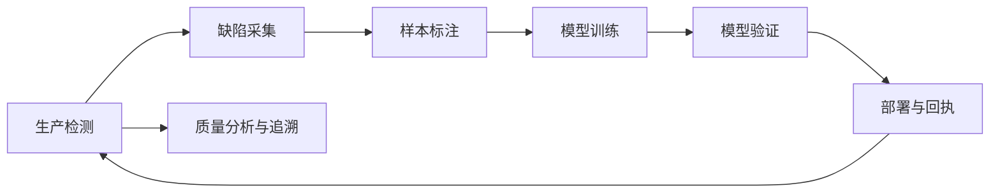
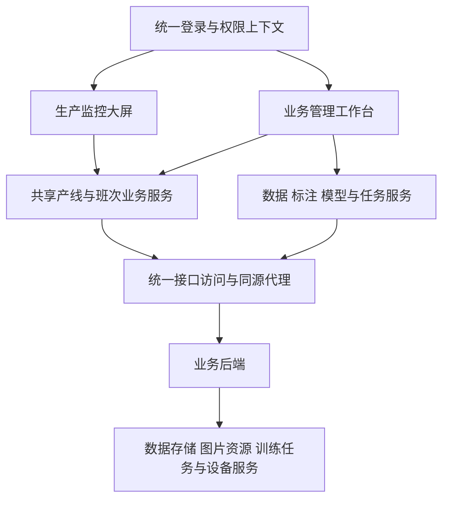

# 智能视觉检测平台技术方案

版本：V2.0  
编制日期：2026-10-16  
适用范围：产线监测与视觉检测业务管理

## 1 项目概述

### 1.1 项目定位

智能视觉检测平台面向生产现场的包装质量检测业务，将产线运行监测、缺陷图片追溯、样本采集与标注、模型训练与验证、质量统计分析纳入同一套系统，支持从现场缺陷发现到检测模型迭代的业务协同。

平台采用统一身份认证和业务接口体系，根据使用场景提供生产监控大屏与管理工作台两种操作界面。监控大屏侧重运行态势和异常发现，管理工作台侧重数据处理和业务操作，两种界面共享产线、缺陷、样本和模型数据，构成同一个项目的完整业务系统。

### 1.2 建设目标

- 集中展示产线状态、产量、剔除数量、缺陷分布和机台评分，使现场人员快速定位异常产线及重点缺陷。
- 建立产线、检测点、相机、图片和缺陷之间的查询关系，支持原图与检测结果对照，满足异常追溯需要。
- 通过数据集、标注和模型任务管理，规范缺陷样本进入模型训练与验证的过程。
- 统一班次统计、缺陷分类与评分展示规则，减少不同页面、不同操作环节的数据理解差异。
- 采用模块化设计和同源接口访问方式，支持现有内网环境部署及后续业务扩展。

### 1.3 设计原则

平台以实际业务数据为基础，明确区分实时累计数据、班次统计数据与模型任务数据。界面应同时表达数据值、数据时间和业务状态；接口失败不得显示为正常零值，任务提交成功不得解释为执行完成。

生产监控与业务管理在统一系统内按职责组织。现场监控界面保持简洁，采集、标注、训练、验证等操作集中在管理工作台，避免复杂管理操作影响现场监测体验。

## 2 建设范围与业务流程

### 2.1 功能范围

| 业务模块 | 主要功能 | 业务价值 |
| --- | --- | --- |
| 产线监测 | 多产线状态、产量、剔除数量、质量图表、评分及详情入口 | 掌握现场生产与检测运行情况 |
| 缺陷追溯 | 检测点查询、品牌与相机筛选、原图与检测图对照 | 定位异常来源并辅助质量复核 |
| 数据集管理 | 缺陷采集数据集、基础缺陷集、样本查询与维护 | 为模型迭代提供受管理的数据资源 |
| 图片标注 | 图像缩放、矩形框选、类别编辑、坐标校验、保存与删除 | 形成可用于训练和验证的标注样本 |
| 缺陷管理 | 标准缺陷、缺陷等级、标注类别及其关联关系 | 统一业务缺陷和模型类别定义 |
| 模型管理 | 模型查询、样本检视、参数读取与维护 | 管理模型资源及相机使用参数 |
| 训练与验证 | 任务创建、状态查询、结果检视、失败处理 | 支持模型训练、验证及效果复核 |
| 质量分析 | 日期与班次查询、缺陷排行、等级分布、机台评分 | 识别高频问题并支持质量改进 |

### 2.2 业务闭环

生产检测发现异常后，操作人员从产线和检测点进入缺陷图片查询，筛选需要复核或采集的样本。样本进入数据集后完成标注和检查，再提交训练或验证任务。经过验证确认的模型可进入部署流程；设备反馈激活成功后，更新当前模型使用记录，并持续跟踪现场检测结果。

模型实际下发涉及服务端任务协调和设备完成回执，属于独立联调验收范围。参数保存、通知发送成功和设备激活成功是不同业务状态，应分别记录，不能以其中一个状态替代整个部署过程完成。

### 2.3 系统职责边界

前端负责交互展示、查询筛选、输入校验、任务状态呈现及操作反馈。服务端负责身份权限、统计计算、数据持久化、文件访问、任务调度和设备指令协调。检测设备负责图像采集、模型执行及约定的设备回执。

训练执行环境、数据库和图片存储由服务端配套提供。浏览器不直接访问生产数据库、设备本地目录或携带对象存储管理密钥，相关操作通过受控接口完成。

## 3 系统总体架构

### 3.1 逻辑架构

系统按展示层、业务服务层、接口访问层和业务后端划分。展示层提供监控大屏和管理工作台；业务服务层负责产线、班次、样本、标注、模型及任务的统一数据处理；接口访问层负责认证、响应适配、请求取消、错误分类与同源图片访问。

监控界面和工作台复用统计口径、评分条件及图片访问规则。页面容器分别适配全屏展示与桌面操作，业务组件避免依赖固定浏览器视口尺寸，以便在两种界面中保持一致行为。

### 3.2 技术选型

| 技术领域 | 采用技术 | 使用说明 |
| --- | --- | --- |
| 前端框架 | Vue 3 | 组件化页面与响应式业务交互 |
| 工程构建 | Vite | 开发服务、环境配置、生产构建与资源拆分 |
| 路由管理 | Vue Router | 监控与管理页面组织、登录访问控制 |
| 界面组件 | Element Plus 与业务组件 | 查询表单、提示、弹窗、分页及通用交互 |
| 图表展示 | ECharts 与评分仪表组件 | 产量、剔除、缺陷分类、等级构成和评分 |
| 接口请求 | Axios | 请求认证、超时、取消与响应处理 |
| 共享状态 | Pinia 与组合式逻辑 | 登录上下文、共享筛选、缓存与公共业务规则 |
| 样式管理 | Sass 与响应式布局 | 大屏视觉、桌面表单和不同分辨率适配 |
| 场景增强 | Three.js 与 GSAP | 按需提供设备场景和交互动画 |

### 3.3 前端模块组织

前端按生产监控、质量统计、数据集、图片标注、缺陷定义、模型与任务六个业务域划分。接口调用、产线编号转换、评分条件、缺陷汇总和图片地址处理放入共享层，避免同一规则在多个页面独立维护。

产线编号采用统一业务标识。页面和接口之间需要兼容中文产线名称与设备编码时，由统一适配逻辑转换，不在页面中使用固定字符位置截取编号。详情页通过产线标识重新查询数据，页面跳转携带的统计值仅用于过渡展示，不作为可信数据来源。

## 4 生产监测与质量展示设计

### 4.1 监控首页

监控首页采用“上部生产场景与整体缺陷统计、底部全宽分析图表”的布局。设备区域展示各产线运行状态和异常检测点；整体缺陷区域提供日期、班次筛选，展示当前统计范围内的缺陷总次数、班次总产量、缺陷等级构成和高频缺陷排行。

底部依次展示产线产量分布、剔除与质量状态组合图、产线评分仪表盘。所有产线同时可见，无需逐条选择才能了解整体情况。

| 展示内容 | 图表形式 | 说明 |
| --- | --- | --- |
| 产线产量 | 柱状图 | 各产线累计产量对比，显示数值和单位 |
| 剔除与质量 | 柱状图叠加折线图 | 剔除数量使用数量轴，合格率使用百分比轴，产线标签显示检测状态 |
| 机台评分 | 九宫格仪表盘 | 显示各产线独立评分，保留零分和实际负分 |
| 缺陷等级构成 | 环形图及等级明细 | 展示 X A B C 等级次数和占比，未知等级单独保留 |
| 缺陷类型排行 | 横向条形图 | 相同缺陷名称跨产线累加，按次数降序排列 |

设备展示应区分运行正常、检测异常、离线和未知状态。检测点异常不应仅以“离线”表示；未返回数据或数据失效时，应提示状态未知，避免历史正常状态被误认为当前状态。

### 4.2 产线详情

产线详情页面上部展示当前设备及检测点入口，下部按“机台评分与产量、检测点运行状态、缺陷分类统计”组织。

机台评分使用所选班次数据，原合格率仪表位置用于展示分数；累计产量、累计剔除和剔除率继续展示生产运行数据。缺陷分类区域采用横向条形图，按当前产线、日期和班次查询，并按 X A B C 等级着色。日期和班次切换后，同步更新左侧评分与右侧缺陷分类，清除上一查询条件下的旧数据。

检测点区域展示点位名称、正常或异常状态。点击检测点进入图片追溯界面，查询该产线对应的缺陷图片。

### 4.3 缺陷图片追溯

图片追溯支持品牌、相机、检测点和产线查询，提供图片分页、原图与检测图切换或对照、放大检视和缺陷名称展示。多缺陷图片应保留全部缺陷名称，图片检测时间优先使用服务端返回的检测时间。

图片列表和图片文件统一经受控接口或同源代理访问。商标纸等特殊点位按照后端约定的产线编码查询，其他检测点使用对应点位标识，不使用单一固定点位覆盖全部产线。

### 4.4 机台评分规则

机台评分采用服务端返回的分值，前端依据所选班次产量判断是否满足展示条件。

| 业务条件 | 显示规则 |
| --- | --- |
| 班次产量小于 1000 | 显示暂时未达到评分条件，并显示当前产量 |
| 班次产量达到 1000 | 允许显示服务端返回的有效评分 |
| 有效评分为零或负数 | 显示实际分值，负分标红，不截断为零 |
| 班次产量未知或评分为空 | 显示暂无评分，不以零分或满分代替 |
| 统计接口失败 | 显示获取失败或等待重试，不判定为未达到评分条件 |

评分说明采用如下计算口径，正式交付时由服务端统一确认和执行。

`Score = 100 - (10X + 3A + 2B + 0.5C) / (M / 10000)`

其中，M 为所选产线、生产日期和班次内商标纸点位的生产数量；X、A、B、C 为相应等级的缺陷数量，按接口约定的检测结果标识去重。评分可为负数。前端的仪表弧形仅表达零至一百分的视觉范围，中央数值保留真实得分。

产量达到 1000 的门槛使用班次接口的 productionCount，不使用其他接口的累计产量替代。为保证不同客户端一致，服务端应统一执行评分条件，并明确未评分原因。

## 5 业务管理功能设计

### 5.1 数据集与基础缺陷集

采集数据集支持按品牌、检测类型和相机筛选、分页、创建、删除和样本查询。数据集名称按既定命名规则生成，避免同一来源样本命名混乱。基础缺陷集按训练或验证用途组织，支持查看样本及已有标注。

产线图片采集通过服务端接口执行，操作人员选择采集日期范围和相机，系统转换为接口要求的日期与相机参数。采集完成后重新查询图片数量和最新状态；需要异步执行时，应展示任务受理和完成状态。

列表总数采用服务端统计值，当前页图表只反映当前页记录。基础集图片数量应由服务端聚合返回，避免通过逐个集合遍历图片分页计算总数，也避免分页上限导致统计截断。

### 5.2 图片标注工作台

图片标注工作台采用样本列表、图像编辑区和类别及属性区布局，支持图片切换、缩放、矩形框选、类别调整、坐标编辑、删除标注、保存及删除图片。

标注使用 YOLO 归一化坐标，包括类别编号、中心点横纵坐标、宽度和高度。坐标必须在图片范围内，矩形宽高应大于零。图像缩放、编辑区尺寸变化和屏幕分辨率变化不得影响保存后的实际坐标。

存在未保存标注时，换图、换页、离开页面和关闭窗口应给出明确提示。保存过程中保留提交快照，防止操作人员继续编辑时把尚未提交的修改错误标为已保存。

### 5.3 标准缺陷与标注类别

标准缺陷用于管理业务缺陷名称、等级、适用产品和示例图片；标注类别用于定义模型训练和推理使用的类别编号。两者通过明确关联关系衔接。

类别编号必须保持稳定。业务缺陷 ID、标签记录 ID、标签列表顺序和模型类别编号应分别定义，不能依靠界面返回顺序推断。涉及已有标注或模型的类别变更，应由服务端校验引用关系并保留版本映射。

缺陷定义及类别删除应执行引用检查。禁止通过前端调整类别顺序使历史标注含义改变；未完成稳定编号和引用校验前，应保留受限删除策略。

### 5.4 模型资源管理

模型资源管理支持按品牌、检测类型和相机查询模型，查看创建者、模型状态和关联样本，并读取或维护相机使用参数。参数变更应明确作用对象和保存结果。

模型删除前检查相机使用情况、任务引用和样本关联。服务端返回模型正在使用等冲突状态时，界面应说明影响对象；确有业务授权的强制删除必须经过再次确认并记录审计信息。

### 5.5 训练与验证任务

训练任务创建时选择匹配的数据集、填写任务名称和训练参数，由服务端受理后异步执行。验证任务选择模型及验证数据集，完成后开放结果图片和对照检视。

任务状态至少区分等待、执行中、成功、失败和未知。前端只展示服务端实际返回的进度；服务端尚未提供百分比时，显示执行阶段或不确定进度动画，不能用固定百分比代替真实进度。

同一任务的提交应具备防重复控制。任务结果未完成时，禁止进入结果检视；失败时展示原因并按授权提供重试或删除入口。任务查询与数据列表查询分别处理，避免分页操作影响正在执行的任务。

### 5.6 质量分析

质量分析按产线、生产日期和班次查询缺陷统计，展示缺陷类型数量、等级分布、高频缺陷及累计占比，并按业务需要导出统计结果。

质量分析和模型验证是不同业务功能，应提供独立页面入口和明确标题。导出内容应包含实际查询条件、统计时间和数据覆盖范围，避免仅导出图表可见部分而使使用者误认为完整数据。

## 6 数据口径与接口设计

### 6.1 核心数据定义

| 数据对象 | 核心字段 | 口径要求 |
| --- | --- | --- |
| 产线运行 | 产线编码 产量 剔除数 检测点状态 | 实时累计数据，明确数据更新时间 |
| 班次统计 | 产线 生产日期 班次 起止时间 班次产量 评分 | 时间边界和评分由服务端解析 |
| 缺陷分类 | 缺陷完整名称 等级 检出次数 | 同名可以汇总，等级不同的缺陷类型分别保留 |
| 样本图片 | 图片标识 原图地址 检测图地址 检测时间 | 图片身份唯一，保持原图与结果对应关系 |
| 图像标注 | 图片标识 类别编号 中心坐标 宽高 | 坐标归一化，类别映射可追溯 |
| 模型任务 | 任务标识 用户 模型 数据集 状态 结果 | 区分已提交与已完成，失败原因可查询 |

实时累计产量和班次产量不得混用。现有实时接口中的 rejectionrate 字段按剔除数量使用，展示时明确标注为剔除数，不直接作为百分比使用。

合格率在产量大于零、剔除数有效且不大于产量时计算。全线综合合格率按有效产量加权，不对各产线百分比进行简单平均。

### 6.2 缺陷次数与评分等级数量

缺陷总次数为各缺陷类型检出次数之和。同一图片可以包含多个缺陷，因此缺陷总次数不等于唯一不合格图片数，也不等于不合格产品数。

整体缺陷图按照完整缺陷名称跨产线汇总，再根据名称等级后缀展示构成。该等级构成属于缺陷类型次数统计，可能与评分公式中按检测结果标识去重的等级数量不同。前端不从缺陷构成图反算机台分数。

部分产线统计失败时，可保留已经返回的数据，但必须显示有效覆盖数量和不完整提示。无缺陷应显示零，接口失败应显示失败或未知，两者不能混淆。

### 6.3 主要接口范围

| 接口范围 | 代表接口 | 主要用途 |
| --- | --- | --- |
| 身份认证 | `/api/Auth/login` `/api/Auth/logout` | 登录 用户信息 退出与认证状态 |
| 实时产线 | `/LineInfo/LineInfo` | 累计产量 剔除数 检测点状态 |
| 班次质量 | `/api/ShiftDefectStatistics/by-line` | 当前或历史班次缺陷 产量与评分 |
| 缺陷图片 | `/api/NgImageInfo/list` | 按产线 点位 品牌与相机查询图片 |
| 采集数据集 | `/api/BrandCamera/*` | 数据集 图片采集及标注维护 |
| 基础缺陷集 | `/api/BaseSet/*` | 基础样本 图片与标注管理 |
| 缺陷与类别 | `/api/Defects/*` `/api/MarkDefects/*` | 标准缺陷 类别及其关联关系 |
| 模型与任务 | `/api/Model/*` `/api/Consult/*` | 模型 训练 验证及辅助标注 |
| 相机配置 | `/api/Camera/*` | 相机使用参数读取与维护 |

以上为现有业务接口范围，具体参数、响应字段和状态码以服务端版本化契约为准。多产线班次汇总、设备部署回执和稳定类别编号等扩展能力，应在相应功能开放前完成契约确认。

### 6.4 日期与班次处理

生产日期统一按北京时间处理，班次名称和起止时间由服务端配置解析。未指定班次时按服务端规则选择当前或默认班次，界面显示响应中的实际班次信息。

跨午夜班次可能对应前一天的生产日期，不能将服务端响应强制改成浏览器当天。历史统计应读取历史保存结果，不由前端自行套用当前规则重新计算。

## 7 技术实现与性能设计

### 7.1 接口访问与异常处理

接口访问层统一处理超时、取消、业务响应适配和错误分类。认证方式按照接口约定配置，在逐步统一认证的过程中保留必要兼容，不将不同认证协议的请求头混合发送。

HTTP 连接成功不等于业务操作成功。应分别处理未登录、无权限、参数错误、资源不存在、资源冲突和服务异常。界面提供查询重试及操作结果反馈，业务失败数据不得进入图表计算。

### 7.2 轮询与数据一致性

实时产线数据按五秒周期刷新，班次缺陷与评分按十五秒周期刷新。请求采用单轮完成后再安排下一轮的方式，避免慢请求不断堆积。切换产线、日期或班次时取消旧请求，并使用请求版本校验，防止旧响应覆盖新查询。

按用户、资源、产线、日期和班次构建共享缓存键，对相同查询去重。页面进入后台时暂停轮询，恢复可见时刷新；连续失败时采用有限退避，降低网络和后端压力。历史日期数据根据业务需要采用按需刷新或较低刷新频率。

多屏部署时，应评估逐线统计对后端实时查询的压力。建议提供多产线班次汇总接口，在单次响应中返回各线数据、覆盖状态和快照时间；单条产线查询保留为详情与异常降级路径。该接口属于按需扩展项。

### 7.3 图表与场景资源管理

图表随容器尺寸变化自动调整，并在页面销毁时释放实例、尺寸监听器和定时器。缺陷类型较多时采用排序和滚动视窗，保留全部统计明细，不通过截断数据隐藏低频缺陷。

三维场景按需加载，正常运行时控制渲染频率；页面不可见时暂停动画，离开页面时释放材质、纹理和渲染资源。现场终端性能不足时使用设备状态图片降级，确保监测数据和操作入口仍然可用。

大屏场景和管理表单采用各自适合的尺寸策略。大屏允许整体比例适配，表单、分页和标注编辑区使用独立响应式布局，避免整体缩放导致输入控件过小或坐标误差。

### 7.4 异步任务与设备部署

训练、验证和部署统一采用可追踪任务标识。任务提交返回受理结果，后续通过任务查询或事件回执确认执行状态，操作人员可以明确区分待执行、执行中、完成和失败。

模型部署流程应包含请求创建、服务端受理、设备下载与校验、设备激活、完成回执和当前模型登记。部署请求关联目标产线、相机、模型版本和文件校验值，并定义超时、重试及重复回执处理规则。

只有设备确认激活成功后，才能登记实际使用模型。缺少完成回执时，保持模型下发入口受控，不以参数保存或通知发送结果代替部署完成。

## 8 安全与权限设计

### 8.1 身份与资源授权

系统统一管理登录态、用户身份和权限上下文。页面访问控制用于改善操作体验，数据查询和写操作权限必须由服务端校验。前端解码令牌不能替代服务端验签与资源授权。

用户编号从可信登录结果或约定的身份声明中获取，不使用固定用户编号，也不把登录记录编号作为业务用户编号。登录过期后统一引导重新认证，并清理与当前用户关联的敏感缓存。

### 8.2 凭据与文件访问

前端源码和构建产物不得包含固定账户口令、长期令牌或对象存储管理密钥。环境文件仅保存非机密连接配置，服务端机密通过受控配置管理。

图片与下载文件仅允许约定的地址协议和受控路径。代理上游由服务器配置确定，不允许浏览器任意指定转发目标。文件上传需要服务端执行类型、大小、名称和访问权限校验。

### 8.3 关键操作保护

数据集删除、图片删除、类别变更、模型删除和设备部署等操作应明确提示作用对象及影响范围。存在引用或正在使用的资源，由服务端返回冲突信息；允许强制操作时，需要再次确认并保留审计记录。

审计记录建议包含用户、操作对象、时间、结果和关联任务标识，便于定位业务变更及异常。审计数据由服务端保存，不能仅保留浏览器提示。

## 9 部署与运行维护

### 9.1 部署结构

系统可部署于现有内网服务器，浏览器通过统一前端地址访问页面和接口。生产环境建议由静态服务托管前端构建产物，并通过同源反向代理访问业务后端和图片资源。

接口和资源代理范围包括产线接口、业务接口、缺陷原图、检测图、标准样例图及约定的其他后端文件路径。通用后端资源代理应固定上游并执行约定的路径重写。设备事件采用实时连接时，还应配置连接升级、超时与断线恢复策略。

开发、测试和生产环境分别配置后端地址；浏览器不直接使用访问者本机地址连接服务器服务。仅复制静态文件不包含接口代理能力，部署时必须同步配置代理规则。

### 9.2 运行保障

运行维护应关注接口可用性、轮询错误率、数据更新时间、任务失败率、图片加载情况和终端资源占用。统计暂不可用时，界面标记数据失效或不完整，避免继续显示未经说明的历史正常状态。

前端日志不记录令牌和口令；接口异常应可关联请求资源和任务标识。长时间运行场景需验证定时器、图表、事件监听和三维资源能够正确回收。

### 9.3 发布与回滚

每次发布归档完整构建产物、依赖锁定信息、接口版本、环境配置和验收记录。先在测试环境确认，再选择小范围现场终端验证，最后扩大部署。

回滚应切换完整静态产物，防止页面入口与资源文件版本混用。涉及标签编号、模型使用记录和数据库结构的变更，需要独立的数据兼容或回滚方案，不能只回退前端文件。

## 10 实施安排与验收标准

### 10.1 实施安排

| 阶段 | 主要工作 | 交付要求 |
| --- | --- | --- |
| 接口与口径确认 | 明确用户身份 产线编码 班次 评分 类别编号及任务状态 | 形成接口清单 字段字典与统计规则 |
| 生产监测完善 | 完成首页 详情 图片追溯 缺陷汇总和评分联动 | 监测数据准确 页面交互与异常状态完整 |
| 数据与标注联调 | 打通数据集 采集 标注 保存及引用校验 | 样本保存后可正确读取 坐标与类别无错配 |
| 模型与任务联调 | 接入训练 验证 参数维护及结果检视 | 任务状态真实 结果可追溯 失败处理明确 |
| 部署与现场验收 | 验证代理 权限 长时运行及发布回滚 | 形成可复现部署包和现场验收记录 |

设备实际下发在完成回执协议、异常处理和设备联调验收后开放。实施周期根据服务端接口、训练环境和现场设备配合情况确定，各阶段以验收结果进入下一阶段。

### 10.2 验收标准

| 验收类别 | 必测内容 | 通过标准 |
| --- | --- | --- |
| 产线监测 | 全线状态 累计产量 剔除数量 详情入口 | 数量与接口一致 状态含义清晰 无数据不显示为正常 |
| 图表展示 | 产量柱形 剔除柱形与合格率折线 缺陷分类及等级构成 | 数据轴 单位 图例与统计范围明确 |
| 机台评分 | 产量为零 999 1000 评分为空 零分与负分 | 门槛正确 实际分数保留 不满足条件时提示明确 |
| 日期与班次 | 当前班次 历史日期 跨午夜 切换查询 | 实际生产日期正确 旧请求不覆盖新数据 |
| 缺陷统计 | 同名汇总 未知等级 空缺陷 部分产线失败 | 汇总准确 覆盖范围明确 不混同次数与产品数量 |
| 图片追溯 | 品牌 相机 点位 分页 原图与检测图 | 查询条件正确 图片对应关系完整 |
| 图像标注 | 缩放 绘制 类别选择 坐标保存 清空 未保存提醒 | 保存后坐标与类别不变更 丢弃修改需确认 |
| 模型任务 | 创建 等待 执行 失败 完成 结果查询 | 不将受理视为完成 不使用虚构进度 |
| 权限与操作 | 登录过期 越权 删除冲突 强制操作 | 服务端校验有效 风险操作有明确确认和记录 |
| 稳定性 | 1366×768 1920×1080 弱网 隐藏页 长时运行 | 布局无裁切 请求不堆积 资源可回收 |
| 发布与回滚 | 构建 环境配置 反向代理 静态资源与整包回滚 | 部署可复现 业务接口和文件访问正常 |

验收以真实业务接口和现场检测数据为依据。模拟数据用于开发和自动化测试，不能代替现场采集、模型训练、验证结果或设备部署验收。对暂不具备联调条件的功能，应明确交付边界并保持操作入口受控。
